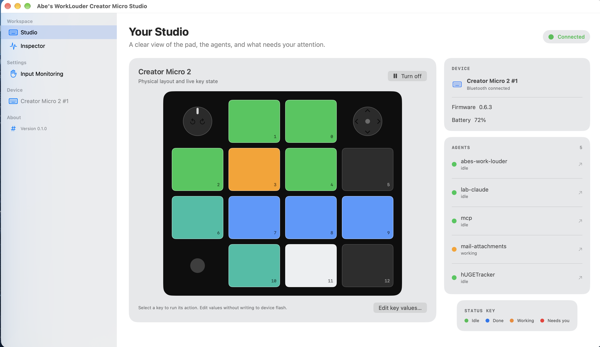

# 🎛️ Abe's WorkLouder Creator Micro Studio

*All work & ~~no~~ play*<br>
*Human after all* `¯\_(ツ)_/¯`


A macOS menu-bar app that lights each running [Herdr](https://herdr.dev) agent
on its own key of a Work Louder
**[Creator Micro 2](https://worklouder.cc/creator-micro-2)**, and jumps to that agent
when you press the key.

It is the bridge itself — no Node, no daemon, nothing to install on the Herdr
side. It reads Herdr's socket directly and drives the pad over raw HID.



**[Download the latest release](https://github.com/abarberenaCPDS/abes-worklouder-creator-micro-studio/releases/latest/download/CreatorMicroStudio.zip)**
· [website](https://abarberenacpds.github.io/abes-worklouder-creator-micro-studio/)
· [hacking guide](docs/hacking.md)

---

## 📦 Install

Download, unzip, drag `AbesWorkLouderCreatorMicroStudio.app` to Applications, and launch it. macOS
will ask for **Input Monitoring**: choose Open System Settings and turn the
studio on. It keeps looking for the pad and connects once the grant applies;
if macOS offers to quit and reopen the app, accept.

If macOS shows nothing — it only asks while it has no decision on record, and
a running app often keeps its old decision after you remove it from the list —
**Request Access** opens a helper after a couple of seconds, and **Show me
how…** (on the Welcome window, the menu-bar panel and the Studio's Input
Monitoring page) opens it directly. The helper shows exactly which app to allow:
its icon, name, Stable or Dev channel, file name (for example
`AbesWorkLouderCreatorMicroStudioDev.app`), folder and bundle ID, with
**Reveal in Finder** and **Copy Path**. Then:

1. **Open System Settings** → Privacy & Security → Input Monitoring.
2. If the app is listed, turn it on. Otherwise click **+** and choose it, or
   drag it in from the Finder window Reveal in Finder opened.
3. **Quit & Reopen**, so the new grant takes effect.

The status line turns green as soon as macOS reports the grant. The Controls
page offers the same helper for **Accessibility**, which newer macOS calls
**Device Control and Data Access**.

Or build it from the Xcode project:

```bash
open AbesWorkLouderCreatorMicroStudio.xcodeproj
```

In Xcode, choose **CreatorMicroStudio** and Run. The Inspector is embedded in the
studio app at build time; the separate **Inspector** scheme is also available.

You will also need a Creator Micro 2 and a running Herdr server with agents in
it. Quit Work Louder's Input app and the Codex desktop app while you use this —
all three drive the same lighting and will overwrite each other.

## 🎛️ What the pad does

**The icon** shows state at a glance: dimmed when off, a coloured dot when
running — green all idle, amber something working, red something needs you —
and a badge when the pad is missing or permission is denied.

**The six dedicated agent keys** focus one agent each, in the order Herdr's own
panel lists them. Colours are red (blocked, breathing), amber (working), blue
(done — finished but not yet looked at) and green (idle — finished and seen).
Herdr distinguishes done from idle by whether you have focused the pane yet, so
blue means something is waiting to be read and green means quiet. The
**underglow** carries the worst state across all agents.

Every physical key defaults to **Focus Agent**. Keys 0–5 focus their assigned
agent and bring its terminal forward; the remaining keys return focus to the
agent currently selected in Herdr. Set `WL_TERMINAL_BUNDLE_ID` if your panes do
not live in Ghostty.

**The dial** tunes reasoning effort and its **push** plays/pauses media
(a host-side media key: it needs the Accessibility permission, see below).
**The joystick** switches model: it puts the model list on screen, up and down
move, right confirms, left cancels. These are only defaults — every key, the
dial (right, left, push) and the joystick (up, down, left, right) can run any
action. Open **Controls** in Studio to change them:

| action | what it does |
|---|---|
| Focus Agent | focuses the key's assigned agent, or returns to Herdr's current agent |
| Focus slot 1–6 | focuses the agent in that slot, from any input |
| Next / previous tab, workspace | moves through Herdr's tabs or workspaces |
| Focus pane up/down/left/right, zoom pane | moves between and zooms Herdr panes |
| Send keys to agent | sends keys such as `ctrl+c esc` to the focused agent |
| Herdr command | runs a Herdr CLI command, such as renaming the current tab (see below) |
| Insert text | types text into the agent's prompt, unsubmitted (the old Prompt Macro) |
| Submit prompt | sends text to the agent and presses Enter |
| Effort up/down, next/previous model, confirm/cancel picker | the Tune controls |
| Scroll up/down/left/right | scrolls 1–20 lines wherever the pointer is * |
| Keyboard shortcut | presses a chord such as `cmd+shift+k`, `pageup`, `f5` * |
| Media key | play/pause, next, previous, volume, mute, brightness * |
| Voice Control | taps right command for dictation (Superwhisper) * |
| Type text | types text into whichever app has focus * |
| Open | opens a URL, a file or folder, or an app by name or bundle id |
| Shell command | runs a command with `/bin/zsh -lc` in the background |
| Do nothing | leaves the input without an action |

\* These post system events, so Studio needs the **Accessibility**
permission. That includes the dial push's default Play/Pause, which the Studio
sends itself instead of the firmware's `KC_MPLY`, so it also only works while
the Studio bridge is on; bind the dial push to something else (or Do nothing)
if you would rather not grant it. The Controls page marks every input that
needs the permission, lists them when it is missing, and asks for it.

### Herdr commands

A **Herdr command** is a Herdr CLI command line without the leading `herdr`,
the same thing you would type in a terminal. For example, this renames the tab
you are looking at in Herdr, asking for the new name with the current one
filled in:

```text
tab rename {tab} {ask:New tab name={tab_label}}
```

Placeholders are read fresh from Herdr when the input is pressed, and only the
ones a command uses are fetched:

| placeholder | value |
|---|---|
| `{tab}`, `{tab_label}` | the id and name of the **current** tab: the focused tab in the focused workspace (not the agent's tab) |
| `{workspace}`, `{workspace_label}` | the id and name of the focused workspace |
| `{pane}` | the focused pane's id |
| `{agent}` | the focused agent's name, else its pane id |
| `{ask:Prompt}`, `{ask:Prompt=Default}` | asks you in a small floating box: Return runs, Esc cancels the action silently. The default may use the placeholders above |

If nothing is focused, the press fails with a message such as “Herdr has no
focused tab right now, so {tab} has no value.” Quoting works like a shell:
`'…'` is literal, `"…"` allows placeholders, and a backslash escapes the next
character. Each placeholder becomes exactly one argument, and nothing goes
through a shell, so a tab name with spaces or `;` in it is passed as-is. The
Studio finds `herdr` through `WL_HERDR_PATH`, `~/.local/bin`,
`/opt/homebrew/bin`, `/usr/local/bin`, `~/.cargo/bin`, then your login shell's
`PATH`, runs it with the Studio's `HERDR_SOCKET_PATH`, and stops it after 10 s.
Herdr's own error message shows up on the Controls page.

The Controls editor has an **Examples** menu, each checked against Herdr
0.9.5's usage text, and shows what a press would run (“Runs: herdr tab rename
w1:t2 ‹New tab name›”):

| example | command |
|---|---|
| Rename current tab | `tab rename {tab} {ask:New tab name={tab_label}}` |
| New tab | `tab create --focus` |
| Rename current workspace | `workspace rename {workspace} {ask:New workspace name={workspace_label}}` |
| New workspace | `workspace create --focus` |
| Rename current pane | `pane rename {pane} {ask:New pane name}` |
| Show notification | `notification show {ask:Notification}` |

Herdr's TUI keybindings such as `prefix+shift+t`, and the opaque command ids
earlier versions stored, are not commands: a saved one shows an error pointing
at the syntax above instead of running.

### Inputs

The 10 and 11 keycaps are physically separate and can be configured
independently. Joystick diagonals and the centre press cannot be bound: the
firmware has no id left for them.

## 🪟 The panel

Click the menu-bar icon for quick status and controls. **Studio** opens the
full Device First workspace with the larger physical pad map, live agent cards,
and a native sidebar for Studio, Controls, Lighting, Herdr and Inspector. Click a mapped key or agent row
to focus it. The menu also has the on/off switch, an "Open at login" toggle,
emulation, and a warning when another app is fighting for the device.

**Off** clears the lights and stops driving, but deliberately leaves the device
keymap alone: rebinding is a flash write, and the keys light instantly on the
way back in if the bindings are still there.

The **Welcome** menu item opens the splash page; manual launches show it before
the menu-bar app starts. The splash uses the same locked app icon: Pure Pad
artwork with an `ABE'S` bezel engraving. Studio, standalone Inspector, and the
website favicons use that same artwork.

## 🔍 The Inspector

Choose **Inspector** in the Studio sidebar to view raw device traffic, decode
notifications, and drive per-key lighting, zones, key walks, and raw JSON-RPC
presets. It temporarily takes the pad from the Studio bridge, then returns
control when you navigate back.

**Inspector changes are temporary.** They last until Studio repaints the pad.
To keep a look, use **Save to Studio** next to the selected keys, the keys zone
or the underglow: it writes that look into Studio's lighting settings in
`config.json` (keys → fixed key colours, keys zone → backlight, underglow →
custom underglow), and Studio reloads them when it takes the pad back. The
standalone Inspector writes the same file.

The **Input Monitoring** sidebar item provides separate Studio and standalone
Inspector permission actions. The standalone Inspector helper is bundled inside
the app, has its own prefixed app name and bundle ID, and requests its own
grant; Studio and the embedded sidebar Inspector share Studio's grant. macOS
may require changing a previously denied grant in System Settings.

## 🎹 Controls, Lighting and Herdr

The Studio sidebar has a page for each of the things Studio keeps:

- **Controls** shows the pad and a list of all 20 inputs. Click to select, ⌘-
  or ⇧-click to select several, then pick an action and its settings (text,
  keys, direction, lines, URL, command, media key). Set one action for every
  selected input at once, **Test** it, or **Reset to default**. Pickers save
  immediately; typed text saves on Return, when the field loses focus, or 3 s
  after the last keystroke.
- **Lighting** sets global brightness and speed, the underglow (agent status,
  a custom look, or off), the backlight (off or custom), the colour and effect
  for each agent state, and fixed at-rest colours for keys that are not showing
  an agent. The pad previews every change live and the page saves 3 seconds
  after your last change: the header shows “Previewing — saves in 3 s” with
  **Save now** and **Revert**, then “Saved”. Leaving the page or switching
  apps saves at once. Turn off **Live preview** to change the pad only when a
  save happens. **Restore defaults** goes back to the built-in look. Agent-slot keys on Focus Agent show their fixed colour
  only while the slot is empty, and voice recording still overrides.
- **Herdr** shows the socket Studio uses and where it came from, whether it is
  connected, Herdr's version and protocol, the last refresh, each agent key's
  slot → agent with its workspace › tab, pane, status and folder, agents no
  input reaches, and every input bound to a Herdr action. Click a row to focus
  the agent.

Everything is saved to `~/.config/creator-micro-studio/config.json`. Actions
and lighting are host-side: they never rewrite the device keymap or consume
flash.

## 🎮 No pad to hand

Tick **Emulate the pad** in the panel and a window opens with a virtual Creator
Micro 2 in it. The bridge drives its lights exactly as it drives the hardware,
and clicking a key — or the dial, or the joystick — sends the same
`v.oai.hid` report back, so the whole loop works with nothing plugged in.

To start with the emulator in Xcode, edit the **CreatorMicroStudio** scheme’s Run
environment variables and set `WL_EMULATE=1`.

It is a stand-in for the firmware rather than a picture of one, and it
reproduces the firmware's more awkward habits deliberately, because those are
the ones that cost time on real hardware:

- it answers `{"ok":1}` to any lighting payload, right or wrong;
- it boots on the **stock F-key keymap**, so the app has to bind the keys
  before anything can light — and a key that is not bound to `KV_OAI_AG*`
  accepts its colour in silence and stays dark;
- an unbound key reports nothing when pressed, because on the pad it would be
  sending a keystroke instead.

The window also shows the RPC traffic, and **Reset** puts a factory pad back.

The emulator lives inside the Studio process. The Inspector sidebar shares that
process; the separately bundled Inspector helper is a different process and
still needs the physical pad.

## ⚙️ Configuration

Everything works without a config file. Studio saves action, prompt and
lighting overrides to `config.json` in `~/.config/creator-micro-studio/`:

```json
{
  "keys": {
    "9":     "Open a pull request for this branch",
    "10+11": "Summarise what you are working on"
  },
  "actions": {
    "0":  "focus-agent",
    "6":  "zoom-pane",
    "7":  "next-tab",
    "8":  "next-workspace",
    "9":  "insert-text",
    "10": "voice",
    "12": {"type": "submit-prompt", "text": "Run the test suite"},
    "13": "effort-up",
    "15": {"type": "scroll", "direction": "up", "amount": 3},
    "17": {"type": "scroll", "direction": "down", "amount": 3},
    "dial-push": {"type": "media-key", "key": "play-pause"},
    "joy-right": {"type": "keyboard-shortcut", "keys": "cmd+shift+]"}
  },
  "lighting": {
    "brightness": 1.0,
    "speed": 0.5,
    "status": {
      "blocked": {"c": "#FF2D2D", "e": "breath"},
      "working": {"c": "#FFA000", "e": "solid"},
      "done":    {"c": "#00B0FF", "e": "solid"},
      "idle":    {"c": "#00C853", "e": "solid"}
    },
    "underglow": {"mode": "status", "c": "#00C853", "e": "rainbow", "b": 1, "s": 0.5},
    "backlight": {"mode": "off", "c": "#FFA000", "e": "solid", "b": 0.3, "s": 0.5},
    "keys": {"7": {"c": "#FFA000", "e": "solid", "b": 0.6}}
  },
  "claude": { "models": ["fable", "opus"], "efforts": ["low", "high"] },
  "codex":  { "models": ["gpt-5.6-sol", "gpt-5.6-codex"] }
}
```

Existing `~/.config/micromanager/config.json` files are still read when the new
location does not exist. Studio rewrites the file atomically and keeps any keys
it does not know about.

**Inputs.** Ids are `0`–`12` for the keys, `13`/`14`/`19` for dial right, left
and push, and `15`/`16`/`17`/`18` for joystick up, left, down and right. The
names `dial-right`, `dial-left`, `dial-push`, `joy-up`, `joy-left`, `joy-down`
and `joy-right` work too; Studio writes numbers. `"10+11"` sets both paired
keycaps, and a specific `"10"` or `"11"` wins over it.

**Actions.** Actions without settings are strings: `focus-agent`,
`next-tab`, `previous-tab`, `next-workspace`, `previous-workspace`,
`zoom-pane`, `effort-up`, `effort-down`, `model-next`, `model-previous`,
`model-picker-confirm`, `model-picker-cancel`, `voice` and `none`. Actions with settings are objects with a `"type"`:
`focus-slot` (`slot` 1–6), `focus-pane` (`direction`), `send-keys` (`keys`),
`herdr-command` (`command`, a Herdr CLI line as above), `insert-text`, `submit-prompt` and `type-text`
(`text`), `scroll` (`direction`, `amount` 1–20), `keyboard-shortcut` (`keys`),
`media-key` (`key`: `play-pause`, `next`, `previous`, `volume-up`,
`volume-down`, `mute`, `brightness-up`, `brightness-down`), `open-url`
(`url`) and `shell-command` (`command`). The old `"macro"` (insert the input's
`"keys"` text), `"cycle-tabs"` (next tab) and `"voice"` with `"keys"` text
(insert that text, as before) still work. The removed GitButler actions
`"stack"` and `"land"` are ignored: an input still set to one uses its default.
Empty prompt text clears that key's suggested or configured text.

**Lighting.** `c` is a `#RRGGBB` colour, `e` an effect (`off`, `solid`,
`snake`, `rainbow`, `breath`, `gradient`, `shallow-breath`), `b` brightness and
`s` speed, both 0–1. An `"unknown"` agent state uses the idle look.

`codex.models` is your copy of what Codex's own `/model` menu offers, in its
order — the joystick steers that menu rather than owning it, so there is nothing
to read it from.

| variable | what it overrides |
|---|---|
| `WL_TERMINAL_BUNDLE_ID` | the terminal to raise (default Ghostty) |
| `HERDR_SOCKET_PATH` | the Herdr socket |
| `WL_HERDR_PATH` | the `herdr` program Herdr commands run |

## 🔏 Why it must be bundled and signed

Input Monitoring is granted to the app’s code signature. For local development,
Xcode can run the app directly; for a distributable build, use an appropriate
Apple Development or Developer ID signing identity in Xcode. Ad-hoc signing is
useful for local builds, but its identity can change between builds and may
require granting Input Monitoring again. The Xcode archive includes the nested
Inspector app and signs it as part of the host app build. See
[docs/signing.md](docs/signing.md) for the permission helper and
troubleshooting.

## 🔌 Only one bridge at a time

Work Louder's Input app and the Codex desktop app drive this same pad. Running
two at once means they overwrite each other. The panel detects this — the device
is opened shared, so we receive other clients' replies, and a response id we
never issued is a reliable tell.

## 🛠️ Development

Code signing, privacy permissions and installing your own build are covered in
[docs/signing.md](docs/signing.md).

### 🧑‍💻 Open and run in Xcode

The GUI apps are native Xcode targets; reusable device and integration code is
in a local Swift package. Open the project:

```bash
open AbesWorkLouderCreatorMicroStudio.xcodeproj
```

In Xcode, choose the **CreatorMicroStudio** scheme to run the menu-bar app or
**Inspector** to run the device inspector. To emulate hardware, edit the
CreatorMicroStudio scheme’s Run environment variables and set `WL_EMULATE=1`.

### 🧪 Stable and Dev apps

Xcode's **Run** (Debug) builds a separate **Dev** app, so development never
disturbs the copy you have installed:

| | Stable (Release / Archive) | Dev (Debug / Run) |
|---|---|---|
| App | `AbesWorkLouderCreatorMicroStudio.app`, in Applications | `AbesWorkLouderCreatorMicroStudioDev.app`, in Xcode's build folder |
| Bundle IDs | `dev.abeisonai.worklouder.creatormicrostudio`, `….inspector` | `….creatormicrostudio.dev`, `….inspector.dev` |
| Embedded Inspector | `Contents/Library/AbesWorkLouderCreatorMicroStudioInspector.app` | `Contents/Library/AbesWorkLouderCreatorMicroStudioInspectorDev.app` |
| Name | Abe's WorkLouder Creator Micro Studio | … Studio **Dev** |
| Icon | the app icon | the app icon with a **DEV** badge |

macOS keys Input Monitoring, saved settings and Open at login on the bundle
ID, so each channel is granted once and keeps its own settings. The Welcome
page shows the version and says when it is the Dev build. Both read the same
`~/.config/creator-micro-studio/config.json` controls and lighting, and only one can drive
the pad at a time — the Run scheme quits both channels' apps before it launches.

To update the stable app, run `./scripts/archive.sh` (or Product → Archive),
export the app, and replace the copy in Applications.

Command-line build and test:

```bash
swift test --package-path Packages/CreatorMicroStudioKit
xcodebuild -project AbesWorkLouderCreatorMicroStudio.xcodeproj -scheme CreatorMicroStudio -destination 'platform=macOS' build
CREATOR_MICRO_STUDIO_LIVE_TESTS=1 swift test --package-path Packages/CreatorMicroStudioKit
./scripts/archive.sh   # create a Release .xcarchive; choose Developer ID to distribute
./scripts/update-icons.sh  # regenerate app icons and website favicons together
```

Tests that access an actual device or Herdr server are
skipped unless `CREATOR_MICRO_STUDIO_LIVE_TESTS=1` is set; use that variable only when
you explicitly intend to contact the live integrations.

| | |
|---|---|
| `Apps/CreatorMicroStudio` | menu-bar app target, feature views, resources and app metadata |
| `Apps/Inspector` | standalone inspector app target and resources |
| `Packages/CreatorMicroStudioKit` | device/HID, Herdr, bridge logic and package tests |
| `scripts` | archive and website asset helpers |
| `docs/hacking.md` | how the pad protocol works, and how to drive it yourself |
| `docs/signing.md` | code signing, permissions and local deployment |
| `docs/index.html` | the website, served by GitHub Pages from `docs/` |

The device protocol — raw-HID JSON-RPC, per-key colour, key and joystick events,
and the keymap binding that makes per-key lighting possible at all — is written
up in full in **[docs/hacking.md](docs/hacking.md)**.

---

An independent interoperability tool for hardware I own. Not affiliated with
Work Louder.
